<!--
  claude-obsidian: un segundo cerebro con IA, gratuito y de código abierto, para Obsidian y Claude Code, creado por Agrici Daniel.
  Agrega fuentes y Claude las lee, las enlaza y las organiza en un grafo de conocimiento conectado de Markdown simple que es tuyo.
  Gestión del conocimiento personal (PKM), toma de notas con IA y una wiki local por defecto, basada en el patrón LLM Wiki de Andrej Karpathy.
  15 skills y 3 agentes. Funciona en Claude Code, Codex, OpenCode, Gemini, ZCode, Cursor y Windsurf. Licencia MIT.
-->



<h1 align="center">claude-obsidian</h1>

<p align="center">
  <b>Tu segundo cerebro con IA para <a href="https://obsidian.md">Obsidian</a>, creado para <a href="https://claude.com/product/claude-code">Claude Code</a>.</b><br />
  Agrega fuentes. Obtén una wiki conectada que crece cada vez que la usas.
</p>

<p align="center"><sub>Traducción al español de <a href="https://github.com/AgriciDaniel/claude-obsidian">claude-obsidian</a>, creado por <a href="https://github.com/AgriciDaniel">Agrici Daniel</a>. Licencia MIT.</sub></p>

<p align="center">
  <a href="#instalación">Instalación</a> ·
  <a href="#ver-la-bóveda">Ver la bóveda</a> ·
  <a href="#15-skills-un-solo-sistema">Skills</a> ·
  <a href="#conoce-al-equipo">Agentes</a> ·
  <a href="#nada-se-pierde">Seguridad</a> ·
  <a href="#da-forma-a-la-bóveda-según-cómo-piensas">Modos</a> ·
  <a href="#preguntas-frecuentes">Preguntas frecuentes</a>
</p>

<p align="center">
  <a href="https://github.com/dpratoo/segundo-cerebro/actions/workflows/test.yml"></a>
  <a href="https://code.claude.com/docs/en/plugins"></a>
  <a href="https://agentskills.io"></a>
  <a href="LICENSE"></a>
  <a href="CHANGELOG.md"></a>
  <a href="https://github.com/dpratoo/segundo-cerebro/stargazers"></a>
  <a href="https://www.skool.com/ai-marketing-hub-pro"></a>
</p>

**claude-obsidian convierte lo que lees en una base de conocimiento que cada vez es más útil.** Deja un estudio, un artículo, una transcripción o tus propias notas en la bóveda, y Claude los lee, escribe notas enlazadas con sus fuentes y lo organiza todo en un único grafo de conocimiento conectado que puedes explorar en Obsidian.

- **Captura.** Pon las fuentes en `inbox/`. Los originales se conservan intactos, para que cada resumen pueda remitir a su origen.
- **Conecta.** Claude escribe páginas enlazadas, índices y mapas de contenido, de modo que las ideas nuevas se suman al grafo en lugar de amontonarse.
- **Pregunta.** Obtén respuestas a partir de lo que tu bóveda ya sabe, con citas y sin cambiar un solo archivo.
- **Guarda.** Conserva como notas las respuestas que valen la pena, una por una, cuando lo pidas.
- **Revisa.** Una revisión de salud encuentra enlaces rotos, páginas huérfanas y vacíos antes de que se propaguen.

Todo queda como archivos Markdown simples en tu computadora. Sin base de datos en la nube, sin dependencia de un proveedor, sin telemetría. Aparte de la herramienta de IA con la que conversas, nada sale de tu equipo a menos que tú lo indiques.

## Ver la bóveda

El resultado es una bóveda de Obsidian normal que sigue siendo útil con o sin IA: explórala en la Vista gráfica o distribúyela como un mapa en Canvas de Obsidian.

<p align="center">
  
  
</p>

<p align="center"><sub>Notas enlazadas en la Vista gráfica · Un mapa de conocimiento en Canvas de Obsidian</sub></p>

## Instalación


Necesitas [Claude Code](https://claude.com/product/claude-code), Python 3.11 o superior y, para la parte visual, [Obsidian](https://obsidian.md). Instala el plugin con dos comandos:

```bash
claude plugin marketplace add dpratoo/segundo-cerebro
claude plugin install claude-obsidian@segundo-cerebro
```

Después abre la carpeta que quieres usar como bóveda e inicia Claude Code ahí:

```bash
claude                                   # inicia Claude Code en la carpeta de tu bóveda

/claude-obsidian:wiki                    # configura la bóveda (antes te muestra una vista previa)
/claude-obsidian:wiki-ingest             # convierte lo que hay en inbox/ en notas enlazadas
/claude-obsidian:wiki-query              # haz una pregunta, respondida con tus notas
/claude-obsidian:save                    # guarda una buena respuesta como nota
/claude-obsidian:wiki-lint               # revisión de salud: enlaces rotos, huérfanas, vacíos
```

Abre la misma carpeta en Obsidian con **Abrir una carpeta como bóveda** para explorar tus notas a medida que crecen.

¿Ya tienes una bóveda de Obsidian? `/claude-obsidian:wiki` puede adoptarla sin mover tus notas. La [guía de instalación](docs/install-guide.md#adoptar-una-bóveda-existente) te explica cómo hacerlo.

<details>
<summary><b>Otras herramientas de IA: Codex, OpenCode, Gemini, ZCode, Cursor y Windsurf</b></summary>
<br />

claude-obsidian es un conjunto de [Agent Skills](https://agentskills.io), así que también funciona en otros hosts. Desde una copia de este repositorio, revisa primero la vista previa de la configuración y luego aplícala:

```bash
git clone https://github.com/dpratoo/segundo-cerebro.git
cd segundo-cerebro
bash scripts/setup-multi-agent.sh --host codex            # vista previa, no escribe nada
bash scripts/setup-multi-agent.sh --host codex --apply    # enlaza las skills
```

Usa `--host opencode`, `--host gemini` o `--host zcode` de la misma manera. Cursor y Windsurf necesitan un espacio de trabajo: `--host cursor --host windsurf --workspace <folder> --apply`. Todos los hosts se explican en la [guía de instalación](docs/install-guide.md).

</details>

<details>
<summary><b>Windows</b></summary>
<br />

En Windows, usa WSL para todo lo que escriba en la bóveda. Windows nativo puede inspeccionar y mostrar vistas previas, y se detiene con un error claro en lugar de escribir. La [guía de Windows y WSL](docs/windows-wsl.md) tiene los detalles.

</details>

<details>
<summary><b>Actualizar, o pasar desde el plugin original</b></summary>
<br />

Para actualizar a la última versión publicada:

```bash
claude plugin marketplace update segundo-cerebro
claude plugin update claude-obsidian@segundo-cerebro
```

¿Ya tienes instalado el plugin original en inglés (`claude-obsidian@agricidaniel-claude-obsidian`)? Desinstálalo y quita su marketplace antes de instalar esta versión, porque los dos usan el mismo nombre de plugin y los mismos comandos `/claude-obsidian:*`:

```bash
claude plugin uninstall claude-obsidian@agricidaniel-claude-obsidian
claude plugin marketplace remove agricidaniel-claude-obsidian
```

Después reinicia Claude Code. La [guía de instalación](docs/install-guide.md) tiene los detalles.

</details>

## 15 skills, un solo sistema



Háblale con palabras sencillas, o llama a cualquier skill por su nombre con `/claude-obsidian:<skill>`. Abre un grupo para ver qué contiene.

<details open>
<summary><b>Crear y usar la wiki</b> (5)</summary>
<br />

| Skill | Qué hace |
|---|---|
| `wiki` | Configura una bóveda nueva o adopta la tuya, comprueba que esté lista y encamina tu solicitud |
| `wiki-ingest` | Convierte las fuentes capturadas en páginas enlazadas con sus fuentes registradas |
| `wiki-query` | Responde con lo que ya está en la bóveda, en solo lectura |
| `save` | Guarda una respuesta o idea como nota, solo cuando lo pides |
| `wiki-lint` | Encuentra enlaces rotos, páginas huérfanas, metadatos faltantes y secciones vacías |

</details>

<details>
<summary><b>Ampliar el flujo de trabajo</b> (7)</summary>
<br />

| Skill | Qué hace |
|---|---|
| `autoresearch` | Investigación web acotada, solo con tu consentimiento, integrada tras una revisión |
| `canvas` | Crea y actualiza tableros de Canvas de Obsidian |
| `defuddle` | Planifica una captura limpia en Markdown de una página web; el limpiador en sí es una herramienta externa opcional |
| `wiki-fold` | Consolida la bitácora de operaciones en resúmenes breves y rastreables |
| `wiki-mode` | Define cómo se organizan las notas nuevas: Genérico, LYT, PARA o Zettelkasten |
| `wiki-retrieve` | Búsqueda local BM25 con reordenamiento opcional |
| `wiki-cli` | Lee y busca mediante la línea de comandos oficial de Obsidian |

</details>

<details>
<summary><b>Referencia</b> (3)</summary>
<br />

| Skill | Qué hace |
|---|---|
| `obsidian-markdown` | Markdown de Obsidian correcto: enlaces, incrustaciones, destacados y propiedades |
| `obsidian-bases` | Tablas, tarjetas, filtros y fórmulas nativos en archivos .base |
| `think` | Un ciclo de revisión estructurado para decisiones difíciles |

</details>

## Conoce al equipo



Detrás de las skills, tres agentes se encargan de la lectura y la verificación más pesadas. Los tres son de **solo lectura**: devuelven borradores e informes, y solo un lugar, el núcleo de transacciones, escribe en tu bóveda.

| Agente | Qué hace |
|---|---|
| `wiki-ingest` | Lee una fuente capturada y devuelve borradores de páginas, con el hash que espera que tenga cada destino |
| `wiki-lint` | Ejecuta el linter de la bóveda, vuelve a comprobar los hallazgos sorprendentes y devuelve un informe de salud |
| `verifier` | Ejecuta pruebas seguras sobre un cambio o una publicación propuestos y ordena por prioridad lo que encuentra |

**Pensado para:**

- **Investigadores y estudiantes** que leen mucho y quieren que cada nota remita a su fuente.
- **Escritores y creadores** que quieren que las ideas de videos, artículos y libros se conecten en lugar de perderse en carpetas.
- **Equipos y personas que construyen productos** y guardan el conocimiento de sus proyectos en Markdown, y quieren una IA que pueda buscarlo, citarlo y mantenerlo ordenado.

## Nada se pierde



Tus notas importan, así que cada cambio en la bóveda funciona como un guardado cuidadoso:

1. **Lee primero.** Claude lee cada nota que va a tocar y registra una huella (un hash SHA-256) de cada una.
2. **Un plan, una aplicación.** Los ayudantes pueden trabajar en paralelo, pero solo devuelven borradores. Claude los combina en un solo plan, lo revisa y lo aplica como una única transacción.
3. **Se deshace si algo falla.** Un diario conserva copias de respaldo durante la escritura. Si se corta la luz a la mitad, `transaction recover` revierte el cambio sin terminar a partir del diario.
4. **Tus ediciones tienen prioridad.** Si cambias una nota en Obsidian mientras Claude planifica, la huella ya no coincide y la escritura se detiene con un conflicto en lugar de sobrescribir tus cambios.

La investigación web, los puntos de control de Git y cualquier cosa que envíe datos fuera de tu equipo son pasos aparte que te preguntan antes.

<details>
<summary><b>Para los curiosos: cómo se elige y se protege la bóveda</b></summary>
<br />

El plugin nunca trata su propia carpeta ni su caché como tu bóveda. La bóveda se elige de forma explícita: mediante `CLAUDE_OBSIDIAN_VAULT`, el `.claude-obsidian.json` más cercano o una única carpeta superior inicializada y clara. Si no está seguro, termina sin escribir.

El bloqueo coordina a los escritores locales que cooperan con él. Otros dispositivos y editores externos no lo comparten, así que conserva copias de respaldo, sobre todo cuando sincronizas archivos de Canvas o de Bases. Lee el [contrato de transacciones](skills/wiki/references/operation-transactions.md), el [contrato de procedencia](skills/wiki/references/provenance.md) y la [guía de la bóveda compuesta](docs/compound-vault-guide.md) para ver todos los detalles.

</details>

## Da forma a la bóveda según cómo piensas



`wiki-mode` define cómo se organizan las notas nuevas, según tu forma habitual de trabajar. Cambiar de modo modifica dónde van las notas nuevas y nunca mueve las anteriores.

| Modo | Cómo se organizan las notas |
|---|---|
| **Genérico** (por defecto) | Fuentes, conceptos, entidades y sesiones |
| **LYT** | Mapas de contenido y notas atómicas enlazadas |
| **PARA** | Proyectos, Áreas, Recursos y Archivos |
| **Zettelkasten** | ID estables, notas atómicas y enlaces densos |

Más en la [guía de modos de metodología](docs/methodology-modes-guide.md).

## Cómo funciona

1. **Captura.** Las fuentes van a `inbox/`. claude-obsidian conserva una copia intacta de cada una, nombrada según su contenido, antes de resumir nada.
2. **Fundamenta.** Cada afirmación importante de una nota se enlaza con la fuente que la respalda. La evidencia débil o contradictoria sigue visible en lugar de suavizarse.
3. **Acumula.** Preguntar, investigar, buscar y el lint usan lo que la bóveda ya sabe, de modo que cada sesión parte de tus notas y no de cero.

La idea sigue el [patrón LLM Wiki de Andrej Karpathy](https://gist.github.com/karpathy/442a6bf555914893e9891c11519de94f): deja que la IA mantenga una wiki que puedes leer, en lugar de una caja negra que no puedes leer.

<details>
<summary><b>Qué puede leer y qué no hoy</b></summary>
<br />

| Entrada o función | Compatibilidad actual |
|---|---|
| Archivos locales | Se capturan y se conservan como copias direccionadas por contenido |
| Imágenes | Metadatos, hash, tamaño y dimensiones cuando están disponibles |
| PDF y EPUB | Metadatos, hash y tamaño; todavía sin extracción de texto integrada |
| Páginas web y YouTube | Se preparan como un plan que tú apruebas; obtenerlas requiere un ejecutor aparte que lo haga cumplir |
| OCR | Requiere una herramienta externa que tú configures |
| Búsqueda (BM25) | Local y determinista |
| Reordenamiento o modelos remotos | Opcional, y solo con tu consentimiento explícito |
| Obsidian CLI | Opcional para lectura y búsqueda |

</details>

<details>
<summary><b>Referencia de la línea de comandos</b></summary>
<br />

Desde un clon de este repositorio, el mismo núcleo está disponible como línea de comandos portátil: `python3 scripts/claude-obsidian.py`. Los comandos que cambian archivos muestran primero un plan y solo se aplican con el hash del plan.

| Comando | Qué hace |
|---|---|
| `doctor --vault PATH` | Muestra qué bóveda está seleccionada y si está lista |
| `init PATH` | Planifica y luego crea una bóveda nueva |
| `adopt PATH` | Planifica y luego adopta una bóveda de Obsidian existente |
| `lint --vault PATH` | Ejecuta la revisión de salud |
| `capture plan` / `capture apply` | Comprueba y luego conserva copias de las fuentes locales |
| `transaction recover --vault PATH` | Restaura la bóveda tras una escritura interrumpida |
| `bench --queries FILE --vault PATH` | Mide la calidad de la búsqueda con tus propias preguntas |

Ejecuta `python3 scripts/claude-obsidian.py --help`, o agrega `--help` a cualquier comando, para ver todas las opciones.

</details>

## Preguntas frecuentes

<details>
<summary><b>¿Qué es claude-obsidian?</b></summary>
<br />

Un segundo cerebro con IA, gratuito y de código abierto, para Obsidian: un sistema de gestión del conocimiento personal (PKM) y de toma de notas con IA que construye un grafo de conocimiento en Markdown simple. Es un plugin de Claude Code (y un conjunto de Agent Skills para otras herramientas de IA) que convierte tus fuentes en notas enlazadas y citadas, responde preguntas a partir de ellas y mantiene la bóveda sana con el tiempo.

</details>

<details>
<summary><b>¿Es gratis?</b></summary>
<br />

Sí. Tiene licencia MIT, sin suscripción y sin rastreo. Lo usas con tu propio plan de Claude Code, o con otra herramienta de IA que ya tengas.

</details>

<details>
<summary><b>¿Necesito Obsidian?</b></summary>
<br />

No, pero es la mejor forma de ver el resultado. La bóveda es Markdown simple, así que sirve cualquier editor. Obsidian añade encima la Vista gráfica, los mapas de Canvas y las tablas de Bases.

</details>

<details>
<summary><b>¿Es un complemento comunitario de Obsidian?</b></summary>
<br />

No. No lo instalas desde la lista de complementos comunitarios de Obsidian. Es un plugin de Claude Code (y un conjunto de Agent Skills para otras herramientas de IA) que trabaja sobre la carpeta de tu bóveda. Obsidian abre el resultado como una bóveda normal, y no se necesita ningún complemento de Obsidian.

</details>

<details>
<summary><b>¿Mis datos salen de mi computadora?</b></summary>
<br />

Tu bóveda se queda en tu computadora como archivos normales. Cuando trabajas con ella en Claude Code, las notas que Claude lee se envían a Claude, el modelo de Anthropic, igual que cualquier otra cosa que abras en Claude Code. La investigación web y los modelos remotos están desactivados hasta que los permitas para una tarea.

</details>

<details>
<summary><b>¿Desordenará mis notas existentes?</b></summary>
<br />

Está diseñado para no hacerlo. Adoptar una bóveda no mueve tus notas, cada cambio se muestra como un plan antes de aplicarse y una escritura interrumpida se puede revertir. Si editas una nota mientras Claude trabaja en ella, la escritura se detiene en lugar de sobrescribir tus cambios. De todos modos, mantén copias de respaldo normales.

</details>

<details>
<summary><b>¿En qué se diferencia de un chat que guarda notas?</b></summary>
<br />

La mayoría de las herramientas de notas con IA guardan texto y se quedan ahí. claude-obsidian conserva las fuentes originales, enlaza cada afirmación con ellas, conecta las notas nuevas con las anteriores y revisa la bóveda en busca de enlaces rotos y vacíos. El conocimiento se acumula en lugar de amontonarse.

</details>

<details>
<summary><b>¿Funciona con Codex, Gemini o Cursor?</b></summary>
<br />

Sí. Las skills siguen el formato abierto Agent Skills. Claude Code recibe el plugin completo; Codex, OpenCode, Gemini, ZCode, Cursor y Windsurf enlazan las mismas skills con un solo script de configuración. Consulta [Instalación](#instalación).

</details>

<details>
<summary><b>Conviene saber: requisitos, límites y desinstalación</b></summary>
<br />

**Requisitos.** Python 3.11 o superior, una versión actual de Claude Code para el plugin (u otro host de Agent Skills), Obsidian para la parte visual y Bash para los scripts de configuración. Git solo se necesita para el desarrollo o los puntos de control.

**Límites.** No es un grabador automático de transcripciones, un servicio de sincronización en la nube ni un verificador de datos, y no reemplaza las copias de respaldo. Los PDF y las páginas web necesitan herramientas adicionales para obtener el texto completo.

**Desinstalación.** Quitar el plugin nunca elimina tu bóveda. Tus notas, fuentes y ajustes de Obsidian siguen siendo tuyos: `claude plugin uninstall claude-obsidian@segundo-cerebro`.

</details>

## Licencia y contribuciones

Licencia MIT, consulta [LICENSE](LICENSE). El diseño sigue el [patrón LLM Wiki de Andrej Karpathy](https://gist.github.com/karpathy/442a6bf555914893e9891c11519de94f) y usa [kepano/obsidian-skills](https://github.com/kepano/obsidian-skills) como referencia para la sintaxis de Markdown, Bases y Canvas de Obsidian. Consulta [ATTRIBUTION.md](ATTRIBUTION.md) y [CITATION.cff](CITATION.cff).

Las contribuciones son bienvenidas: lee primero [CONTRIBUTING.md](CONTRIBUTING.md) y ejecuta `make test` antes de abrir un pull request. Reporta los problemas de seguridad como se describe en [SECURITY.md](SECURITY.md) y lee [PRIVACY.md](PRIVACY.md) para saber qué se queda en tu equipo. Las notas de cada versión están en el [registro de cambios](CHANGELOG.md) y el [código de conducta](CODE_OF_CONDUCT.md) se aplica en todas partes. Los agentes de IA que programan en este repositorio empiezan en [AGENTS.md](AGENTS.md).

**Gracias** a todas las personas que han ayudado. Pull requests: [@Ychris12138](https://github.com/Ychris12138), [@Marcos64s](https://github.com/Marcos64s), [@hphsu](https://github.com/hphsu), [@vinsocci](https://github.com/vinsocci), [@miraclemanza](https://github.com/miraclemanza), [@maartengoet](https://github.com/maartengoet), [@Lion-1209](https://github.com/Lion-1209), [@HectorBernstorff](https://github.com/HectorBernstorff), [@Packetslave](https://github.com/Packetslave), [@CooperSheroy](https://github.com/CooperSheroy), [@yotamleo](https://github.com/yotamleo), [@ketpatil77](https://github.com/ketpatil77), [@tilusnet](https://github.com/tilusnet), [@GPezzuti](https://github.com/GPezzuti), [@STiFLeR7](https://github.com/STiFLeR7). Reportes de problemas (issues): [@RoelKluin](https://github.com/RoelKluin), [@threnard](https://github.com/threnard), [@szrenwei](https://github.com/szrenwei), [@ppuri2](https://github.com/ppuri2), [@cosmos75](https://github.com/cosmos75), [@simonc](https://github.com/simonc).

## Historial de estrellas del proyecto original

Si claude-obsidian te resulta útil, una estrella ayuda a que otras personas lo encuentren. Este gráfico muestra las estrellas del proyecto original en inglés, no las de esta traducción.

<p align="center">
  <a href="https://www.star-history.com/#agricidaniel/claude-obsidian&Date">
    <picture>
      <source media="(prefers-color-scheme: dark)" srcset="https://api.star-history.com/svg?repos=agricidaniel/claude-obsidian&type=Date&theme=dark" />
      <source media="(prefers-color-scheme: light)" srcset="https://api.star-history.com/svg?repos=agricidaniel/claude-obsidian&type=Date" />
      
    </picture>
  </a>
</p>

## Autor

Creado por **[Agrici Daniel](https://agricidaniel.com/about)**, arquitecto de flujos de trabajo con IA, con la ayuda de la comunidad [AI Marketing Hub Pro](https://www.skool.com/ai-marketing-hub-pro).



<p align="center">
  <a href="https://www.youtube.com/@AgriciDaniel"></a>
  <a href="https://www.skool.com/ai-marketing-hub"></a>
  <a href="https://www.skool.com/ai-marketing-hub-pro"></a>
</p>
