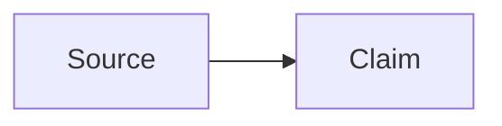

# Obsidian Flavored Markdown

Úsala como alternativa compacta para la sintaxis específica de Obsidian. Para
preguntas detalladas o que dependen de la versión, prefiere una skill
`obsidian-markdown` de `kepano/obsidian-skills` instalada por separado, si está
disponible, y después la [Ayuda de Obsidian](https://help.obsidian.md/) vigente.

Resuelve la raíz del producto instalado a partir de la ubicación propia de esta
skill, no desde la bóveda ni desde el directorio de trabajo actual:

```bash
PRODUCT_ROOT=/absolute/path/to/installed/claude-obsidian
CORE="$PRODUCT_ROOT/scripts/claude-obsidian.py"
test -f "$CORE"
```

Cada enlace `../wiki/references/` de este archivo se resuelve de la misma
forma: respecto del directorio propio de esta skill dentro de `$PRODUCT_ROOT`,
nunca respecto del directorio `wiki/` de la bóveda seleccionada.

Responde las preguntas de sintaxis en modo de solo lectura. Si el usuario pide
editar la bóveda, redacta la nota completa, lee
[operation-transactions.md](../wiki/references/operation-transactions.md) y
construye un solo paquete `claude-obsidian.transaction.v1` con
`operation_type: markdown` y únicamente destinos en `wiki/`. Inspecciónalo,
define `APPROVAL_SHA256` con el `approval_sha256` devuelto después de revisarlo
y aplícalo mediante el mismo plan vinculado a la bóveda. La creación o
eliminación de una página canónica incluye en ese paquete una actualización del
índice activo o MOC; actualiza la vista general solo cuando haya cambiado su
síntesis estable de alto nivel:

```bash
python3 "$CORE" transaction inspect "$BUNDLE" --vault "$VAULT"
python3 "$CORE" transaction apply "$BUNDLE" --vault "$VAULT" \
  --approved-plan-sha256 "$APPROVAL_SHA256"
```

Nunca escribas una nota directamente.

## Propiedades

Usa propiedades YAML planas y fechas `YYYY-MM-DD`. Pon entre comillas los
wikilinks dentro de YAML.

```yaml
---
type: concept
title: "Contextual Retrieval"
created: 2026-07-11
updated: 2026-07-11
status: developing
tags:
  - retrieval
  - ai/knowledge
aliases:
  - Context-aware retrieval
related:
  - "[[Retrieval]]"
sources:
  - "[[Anthropic Contextual Retrieval]]"
---
```

No anides objetos en las propiedades generadas de la wiki. Usa listas en bloque
en lugar de arreglos YAML en línea. Una etiqueta solo numérica no es válida en
Obsidian aunque esté entre comillas como cadena YAML. Usa `year/2026` o
`y2026`, o guarda un número en una propiedad `year`. Las etiquetas necesitan al
menos un carácter no numérico; las etiquetas Unicode válidas siguen siendo
compatibles. Consulta [Etiquetas](https://obsidian.md/help/tags), revisado el
2026-10-17. Conserva las propiedades existentes desconocidas salvo que la
edición solicitada las cambie.

## Wikilinks e incrustaciones

```markdown
[[Note Name]]
[[Note Name|Texto visible]]
[[Note Name#Heading]]
[[Note Name#^block-id]]
[[Folder/Note Name]]

Este párrafo es direccionable. ^evidence-block

![[Note Name#Summary]]
![[diagram.png|480]]
![[paper.pdf#page=3]]
```

Haz coincidir exactamente el nombre de archivo de destino. Usa una ruta de
carpeta relativa a la bóveda cuando un nombre base sea ambiguo. Usa enlaces
Markdown estándar para las URL externas y wikilinks para las notas de esta
bóveda.

## Destacados

```markdown
> [!note]
> Contexto de apoyo.

> [!warning] Revisión requerida
> Esta afirmación tiene evidencia contradictoria.

> [!question]- Pregunta abierta
> ¿Qué evidencia resolvería esto?
```

`-` inicia el destacado contraído y `+` lo inicia expandido. Los tipos
integrados más comunes incluyen `note`, `abstract`, `info`, `todo`, `tip`,
`success`, `question`, `warning`, `failure`, `danger`, `bug`, `example` y
`quote`. Conserva los tipos de destacado personalizados de la bóveda en lugar de
reescribirlos.

## Otra sintaxis de Obsidian

````markdown
#inline-tag #nested/tag

==Texto resaltado==

Texto visible %%comentario oculto%%

Matemáticas en línea: $E = mc^2$

$$
\int_0^1 x^2\,dx = \frac{1}{3}
$$


````

Los encabezados, listas, tareas, tablas, bloques de código y notas al pie
estándar de CommonMark/GFM siguen siendo válidos. Evita HTML cuando basta con
Markdown nativo.

## Valida una nota redactada

- Analiza el límite del YAML y mantén coherentes los tipos de las propiedades.
- Verifica todo destino interno, encabezado y referencia a bloque que se pueda
  comprobar localmente; nunca inventes un destino para que un enlace parezca
  completo.
- Mantén la redacción de la evidencia separada de la inferencia y conserva los
  localizadores de la fuente.
- Asegúrate de que los bloques de código y las citas de los destacados estén
  balanceados.
- Ejecuta el lint determinista de la wiki después de una modificación solicitada
  e informa los hallazgos restantes sin repararlos en silencio.

Para las páginas que citan fuentes, sigue también
[provenance.md](../wiki/references/provenance.md). Tras una edición aplicada,
informa el ID de operación de la transacción y las rutas exactas modificadas.
